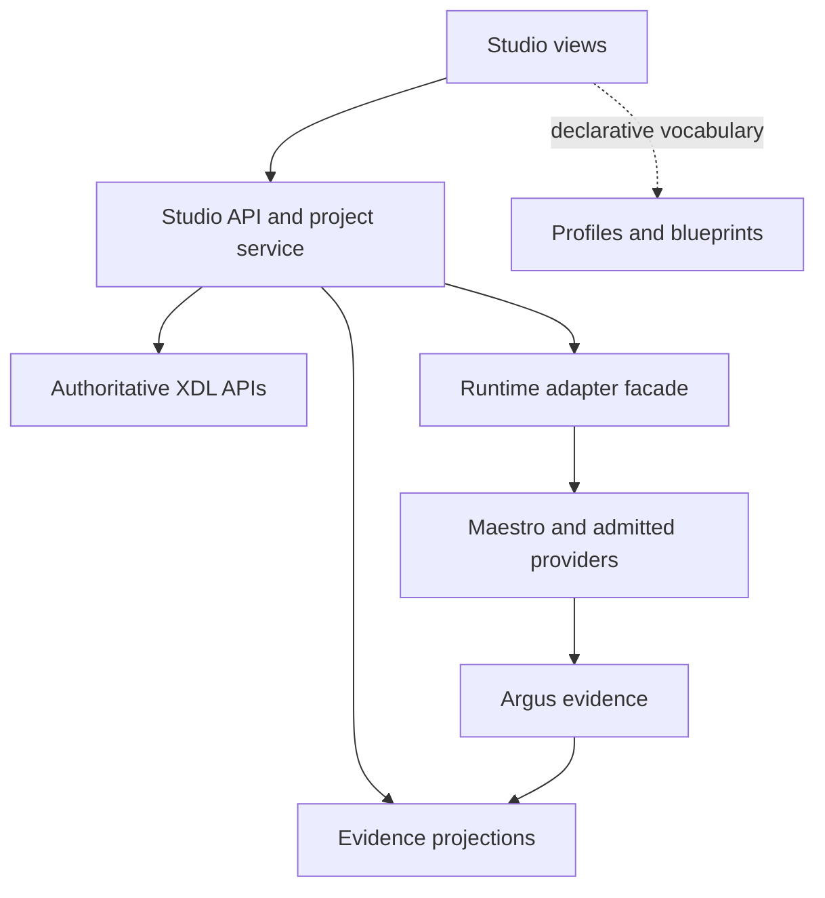

# Implementation Plan: Industry-agnostic X-Verse Studio

**Feature**: `001-industry-agnostic-studio`\
**Date**: 2026-10-25\
**Status**: implementation plan; no application capability is delivered by this document.\
**Specification**: [spec.md](spec.md) · **Tasks**: [tasks.md](tasks.md)

## Summary

Build a web-based, local-first engineering workbench around the existing XDL model, with the backend running natively on Linux or Windows and the user interface accessed through a browser. A user opens or composes a System, chooses compatible realizations, connects interfaces, creates a Scenario, runs an admitted experiment, and inspects correlated observations. The five views—Model, Connections, Deployment, Experiments, Results—are projections of shared identities. Industry profiles supply terminology; they never fork the editor or redefine XDL semantics.

Deliver the entire M0–M4 scope incrementally. A milestone is usable only after its acceptance evidence exists. An unavailable external capability blocks that integration, not unrelated offline authoring work. Future M5 items are roadmap entries, not hidden acceptance obligations for Studio 1.0.

## Technical context

| Concern | Planned choice | Reason / boundary |
|---|---|---|
| Frontend | React, TypeScript, React Flow, schema-aware forms and source editor | Interactive graph and synchronized forms; React Flow state is a projection, not the project format. |
| Backend | Python, FastAPI, Pydantic | Close integration with authoritative Python XDL validation/compiler APIs; typed HTTP boundary. |
| Streaming | HTTP server-sent events (SSE), cursor-based catch-up | Commands stay request/response; events reconnect independently of browser lifetime. |
| Metadata | SQLite, migration scripts, transactional command/run bookkeeping | Single-host initial product; metadata is rebuildable where it indexes external evidence. |
| Files | Authored XDL, presentation sidecars, pinned project manifest, immutable run snapshots | Portable authored inputs and auditability; credentials are external references. |
| Runtime integration | Versioned Studio adapter facade over admitted platform/provider contracts | Maestro owns intra-run lifecycle, time and resource scheduling. Studio may queue independent admitted runs for a bounded campaign; it does not duplicate that intra-run scheduler. |
| Evidence | Argus readers and indexed projections | Do not rewrite historical Argus records or reinterpret integrity failures as success. |
| Toolchain | Node LTS + npm lockfile; supported Python + uv lockfile | Exact versions selected, compatibility-tested and pinned during M0. No unspecified floating release dependency in delivery. |
| Initial deployment | Native Linux or Windows backend; browser UI served by backend | Install/start/stop/restart and offline core workflows on both hosts. WSL, containers or a separate Linux machine are not prerequisites for Windows Studio. Remote exposure is outside M0–M4. |
| Verification | Python contract/integration tests; frontend component tests; Playwright user journeys | Tests exercise invariants and failure boundaries, not merely DOM presence. |

No application packages or dependency locks are created by this plan. At M0, validate the chosen versions against the exact XDL package and admitted runtime bindings on both native host operating systems. Keep any CARLA client interpreter or native gateway requirement inside its provider environment; do not force its Python version or operating system onto Studio. Provider support is separate from Studio host support: a Linux-only provider is explicitly unavailable on Windows until a native compatible integration is admitted.

Mandatory packaging scope is a locally installable backend and native foreground or launcher-managed background process with documented install/start/stop/restart/uninstall procedures. OS service-manager registration and automatic start are optional additions with their own tested Linux/Windows implementations; no untested systemd or Windows Service Control Manager behaviour is implied. `scripts/package_studio.py` is the shared packaging entry point; shell-only launch scripts cannot satisfy Windows delivery.

## Constitution check

Implementation must satisfy [.specify/memory/constitution.md](../../.specify/memory/constitution.md). In particular: XDL is authoritative; domain terminology is extensible; legacy assets remain owned externally; operations require actual capabilities; evidence claims are scoped; and failure/cleanup states are explicit. The implementation review must repeat this check with exact candidate evidence.

## Architecture and ownership



1. **Frontend** renders projections and sends semantic edit commands. Selection carries stable resource/element references between graph, forms, source, diagnostics and results. All authoritative validation and execution admission are server-side.
2. **Project service** owns allowed-root file access, revision concurrency, atomic edits and import/export. It calls the installed XDL validator/compiler, retaining source maps. It preserves unrecognized content for inspection and blocks execution when semantic resolution fails.
3. **Runtime facade** exposes only reviewed, typed operations. It records commands durably before delegation, serializes conflicting mutations and maps provider results without inventing capabilities. No browser-supplied shell command is accepted.
4. **Maestro/provider layer** owns process/device authority, leases, lifecycle and cleanup. Studio never kills by process name, guesses ownership from a port, or directly activates a native X-COM gateway.
5. **Evidence service** indexes validated Argus records, timestamps, gaps and integrity state. A separate presentation index can be rebuilt. Canonical evidence and source snapshots remain immutable.
6. **Profiles** supply namespaced schemas, interface semantics, labels, icons and documented forms. **Providers** supply executable integrations. **Blueprints** supply composed examples and experiments. Installing a project or profile does not install or execute provider code.

## Baseline dependency admission

Inspect [sources.md](sources.md) and current upstream contracts before coding each adapter. The inspected tested release record is rc.1 dated 2026-10-24. Newer repository heads were observed on 2026-10-25; M0 must inspect and pin a compatible admitted successor rather than assume its runtime boundaries remain unchanged. See sources.md for both sets of identities.

| Dependency | Known source boundary | M0 outcome / subsequent gate |
|---|---|---|
| DEP-XDL | Local validator, normalizer and experiment compiler exist; API/schema versions matter. | Record package version, source revision and digests; prove equivalent CLI/API plans and diagnostic source locations. |
| DEP-RUN | The inspected rc.1 blueprint uses trusted-host `_OriginalRuntimeRun`; its external `RuntimeService` path remains closed. That harness is Linux-specific. | Evaluate a fixed-argv wrapper of the documented run-live.sh harness on its supported Linux host, or an admitted successor service. Prove requested/effective input equality; see DEP-RUN-CONFIG below. Windows needs an admitted native provider for the same live capability; unavailable integrations must not disable native Studio authoring/fixture workflows. |
| DEP-RUN-CONFIG | The inspected harness generates XDL internally through build_documents; a preset invocation does not imply support for GUI-authored inputs or changed parameters. | Require an offline effective-input/plan identity contract and exact requested/effective digest comparison before start. Edited-parameter/live acceptance remains blocked until an admitted successor consumes the requested declared inputs. |
| DEP-ARGUS | Read/verify/export APIs exist; integrity and collection limitations remain meaningful. | Use compatible reader contracts and keep original verdicts. Missing evidence remains missing. |
| DEP-FLOW | Lite flow runtime mirrors bounded X-COM rules; it does not activate the C++ core. | Display actual source/provider scope. Native X-COM introspection is a later admitted integration. |
| DEP-ASSET | Arbitrary physical devices are not demonstrated by Lite. | M3 needs one identified compatible test asset, reviewed provider and declared stop/observe/stimulate capabilities. Fixtures alone do not close physical acceptance. |
| DEP-METRIC | XDL acceptance expressions can be declarative strings without a standardized evaluator. | M4 introduces a versioned, bounded evaluator contract; never use Python/JavaScript eval or claim existing strings already execute. |

Store the results as `config/platform-compatibility.json` during M0. Missing checks are `unknown` or `unsupported` with a diagnostic. Add upstream capability proposals to `docs/integration-dependencies.md` when required; changes in other repositories require their own authorized scope. Continue Studio fixtures and offline work while such dependencies are unresolved.

## Target source layout

```text
apps/studio-web/src/
  app/                     application shell and navigation
  features/
    projects/              project home and blueprint onboarding
    model/                 graph/tree projection, selection, history and run overlays
    inspector/             schema-backed forms and selected-element properties
    source/                authored XDL and source diagnostics
    catalog/               admitted definitions and artifact metadata
    elements/              Add element and instance wizards
    connections/           typed connections and communication projections
    deployments/           variants, realization, placement and resources
    profiles/              profile vocabulary and sanitized presentation
    preflight/             readiness, plan preview and blocked reasons
    runs/                  lifecycle controls and reconnecting sessions
    diagnostics/           evidence-linked explanations
    lab/                   physical assets, reservations and hybrid controls
    experiments/           scenario, observer, fault and assertion forms
    campaigns/             bounded independent-run queues
    comparison/            baseline and recorded-run comparisons
    exchange/              project/evidence import and export
    results/               plots, events, logs and evidence states
  api/                     generated API types and reconnecting SSE client
services/studio-api/src/xverse_studio/
  api/                     HTTP routes and error mapping
  security/                sessions, origins and authority checks
  imports/                 staged bounded inert archive import
  projects/                safe I/O, revisions and source maps
  models/                  typed XDL semantic edits and graph projections
  xdl/                     adapters to authoritative platform APIs
  catalog/                 definition and artifact metadata admission
  profiles/                namespaced schemas and presentation admission
  connections/             connection validation and projections
  deployments/             variant and effective-binding resolution
  preflight/               snapshot-bound readiness and admission
  providers/               capability facade and admitted registry
  integrations/lite/       admitted real Lite binding
  runs/                    run snapshots, controls, cleanup and reconciliation
  commands/                durable idempotent command dispatch
  events/                  cursor stream and catch-up
  diagnostics/             structured evidence-linked findings
  lab/                     assets, reservations, authority and time quality
  evidence/                Argus reader adapters and derived indexes
  experiments/             scenario/observer/fault authoring and compilation
  assertions/              bounded typed evaluation
  campaigns/               independent-run coordination
  comparison/              baseline and clock/quantity compatibility
  exchange/                project/evidence export
  annotations/             revisioned trace links and separate commentary
  retention/               dependency-aware retention and explicit deletion
  storage/                 SQLite models and migrations
  host/                    native paths, launcher, process ownership and shutdown
packages/contracts/        generated OpenAPI/client schemas and event schema
config/                    supported compatibility set and limits
tests/contract/            shared API/provider/format/event contract verification
tests/integration/         real XDL APIs, owned runtime fixture and failure recovery
tests/e2e/                 browser user journeys and accessibility
tests/performance/         declared workloads and repeatable measurements
tests/platform/            Linux/Windows native installation, paths and lifecycle matrix
tests/fixtures/            neutral, automotive and process-control fixtures
docs/implementation/       operator, developer, migration and release guidance
```

Directories above are implementation targets, not existing capabilities. Root-level scripts and CI will expose documented install, development, verification and package commands during M0; do not write quickstart commands that have not been implemented.

## Milestones and vertical slices

### M0 — Foundation and contracts

Pin toolchains and upstream inputs for native Linux and Windows. Establish app/API skeleton, portable owned fixture provider, database migrations, project revision service, local session protection and contract tests. Implement safe import without execution, capability discovery and basic XDL validation/compilation. Produce the per-OS supported capability matrix and resolve DEP-RUN for real Lite execution on each claimed provider/host combination. A fixture permits service testing but is visibly labelled fixture-only. A missing Windows runtime integration cannot be hidden behind an automatic WSL requirement.

Exit: contracts can be exercised; platform compatibility is identified; model-only and owned-fixture workflows work offline on native Linux and Windows; no runtime success is claimed for an unavailable provider/OS integration.

### M1 — Guided operation / Studio 0.1

Open one admitted Lite blueprint through onboarding. Edit exposed parameters, validate, compile, preflight, preview, start, observe, stop and inspect evidence. Handle absent artifacts, unavailable simulator, stale preflight, duplicate command, browser loss, backend restart, failed cleanup and partial evidence. Show model, target, process, data and experiment status separately. Preserve current Lite limits through capabilities rather than hard-coded assumptions.

Exit: an actual admitted Lite run and an intentionally failed run complete the user journey with truthful state/evidence. A prepared novice walkthrough is recorded; hardware or new native X-COM support is not inferred.

### M2 — Visual composition and domain neutrality / Studio 0.2

Deliver catalog, element wizard, hierarchical graph, ports, semantic edits, source view, connection validation, layout sidecar, saved deployment variants and semantic diff. Prove round-trip preservation and CLI parity. Add Studio-owned process-control fixtures/reference-provider cases alongside automotive cases for offline contract proof. Nominate a bounded process-control blueprint/provider through the companion repositories for admitted live two-domain proof; missing integration is an explicit dependency, not permission to modify those repositories. Their domain terms must reside in packages rather than shared conditional branches. Mixed-profile composition is tested, including namespace conflicts.

Exit: both admitted domain examples can be composed and run through the same contracts. Offline reference-provider success is recorded separately and cannot close a missing live domain-integration gate. A declared simple process model does not claim industrial fidelity. Unknown profile content is preserved and execution remains blocked until resolved.

### M3 — Hybrid laboratory / Studio 0.3

Implement physical asset registration, discovery restricted to explicit scopes, reservations, identity checks, observe-only connection and capability-gated stimulation. Record device/firmware identity where observable and handle substitution, ownership loss and disconnect. Swap an admitted simulated realization for an identified physical realization without changing logical identity; revalidate interfaces, limits and time mappings.

Exit: owned fixture negative tests plus one real hardware integration with recorded environment and shutdown evidence. Lack of the asset keeps this gate blocked, while completed software remains reviewable.

### M4 — Experiment management / Studio 1.0

Deliver scenario timeline, supported fault activation/recovery, bounded assertion/metric evaluation, immutable run comparison, local bounded parameter campaigns, cancellation and evidence export. Support source-to-observation navigation and explicit observation gaps. Use assertion verdicts `pass|fail|indeterminate`, with separate execution status. Absent evaluator/capability is `unavailable` with no verdict; insufficient evidence yields `indeterminate`. See contracts/experiment-evaluation.md for the bounded typed language and aggregation rules.

Exit: the complete M0–M4 acceptance suite passes on the declared environments; run evidence identifies exact inputs, versions and limits; operational documentation and upgrade/restore checks are complete.

### M5 — Explicit future roadmap

Specify separately before implementation: distributed execution and remote access, collaboration, broad SysML/ARXML/DBC/FMI/SSP imports, native X-COM tooling, general physical co-simulation solvers, marketplace distribution, and optional AI assistance. M0–M4 must preserve extension points without pretending these features exist.

## Critical design details

- Logical role, realization class and placement are independent. `Device` is a logical thing; a physical asset is an environment binding.
- Graph edge types are explicit: communication, model coupling, deployment, traceability. Only compatible communication creates XDL flows. A model coupling requires a compatible modelling provider and timing/numerical contract; unsupported couplings are blocked.
- Feedback cycles are legal when supported. Validate timing and causality; do not blanket-reject cycles with a generic graph library option.
- A run uses a frozen snapshot. Autosave and new edits create project revisions for later runs; they cannot mutate an existing snapshot.
- The backend keeps runs independent of the browser. On backend restart, reconcile recorded authority with the provider; never retry start blindly. Unknown ownership is surfaced and does not become permission to kill or restart a workload.
- Commands use idempotency keys and compare-and-swap state versions. Preflight results are tied to exact semantic inputs, provider capabilities and live readiness evidence; they are not reusable after relevant changes.
- Simulator time, wall time and device time are recorded distinctly. Correlation requires declared mappings and uncertainty; unsynchronized samples are not silently plotted as a common clock.
- SQLite is not a second runtime journal. Store command acceptance/reconciliation and index references, retaining canonical Argus evidence separately.

## Cross-platform host contract

- Use a browser-delivered application shell. A desktop wrapper may be optional later; it cannot be the only way to operate Studio.
- Separate `host/` path/process adapters from domain and runtime semantics. Use native path APIs and explicit configured data roots, not embedded `/home`, drive letters, Unix sockets or Bash assumptions.
- On Linux use declared XDG/app-local defaults; on Windows use the declared per-user application-data location. Record actual paths in local configuration, not portable XDL identity. Support paths with spaces and Unicode; diagnose unavailable/network-backed roots explicitly.
- Enforce path containment after native normalization and link resolution. Test case-insensitive collisions, Windows reserved device names, alternate data stream syntax, drive-relative/UNC paths, Linux symlinks and Windows junction/reparse-point escapes. Portable archives reject ambiguous/colliding paths on either supported host.
- Spawn admitted executables with argument vectors and explicit environment/cwd; never concatenate user text into a shell. Linux process groups/signals and Windows process handles/job/termination mechanisms require separate tested implementations. Do not pretend SIGTERM semantics are portable or infer child ownership from PID reuse.
- Reconcile backend/owned-child processes after crash and stop on both OSes; handle file-lock/rename and SQLite shutdown differences. Startup must not require administrator/root privileges for ordinary per-user authoring and fixtures.
- Run backend contract/integration tests, packaged install/start/stop/restart and representative browser flows natively on both Linux and Windows. Record browser/version, OS edition/version, architecture, filesystem and toolchain per lane. WSL or Linux containers on Windows do not close the native Windows lane.
- Provider descriptors advertise OS/architecture and external dependency requirements. Feature controls explain unsupported providers on that host; their absence does not remove core authoring or results inspection.

## Verification strategy

Use the scenario IDs in [acceptance.md](acceptance.md) and requirement mapping in [tasks.md](tasks.md). Plan meaningful tests at contract boundaries: source-preserving edits; unsupported extensions; semantic digest invariance under layout; type/unit/clock incompatibility; preflight expiry; start idempotency; event replay; partial startup; resource exhaustion; reconciliation; hardware reservation loss; evidence corruption; metric missing-data semantics; and two-domain use through one editor.

Performance targets are acceptance targets, not measurements. Establish a reference machine/browser/runtime dataset in M0, retain raw commands and timing distributions, and evaluate the specification's NFRs against that identity. Decimate plot display without discarding canonical evidence. Bounded queues must disclose dropped live presentation samples; they may not silently drop required evidence.

Maintain separate native Linux and native Windows verification lanes. Run common API/XDL/project/fixture/browser workflows in each; run real provider lanes only where that provider is admitted, reporting unsupported combinations explicitly. Core cross-platform acceptance cannot be waived because the first real Lite provider is Linux-only.

Review each milestone separately from implementation. Record findings and fix affected issues in a successor candidate. Re-run affected tests after changes. Runtime/hardware-dependent tests cannot be replaced by screenshots or mocked success.

## Risks and mitigations

| Risk | Mitigation |
|---|---|
| Existing runtime lacks public service contract | Admit a narrow adapter; retain fixture/model-only development; record the precise upstream dependency. |
| Canvas creates a competing model | Semantic edits through XDL adapters; source maps; round-trip and digest tests; layout isolated. |
| Plugin brings arbitrary execution into a project | Declarative profiles; separately installed providers; no auto-install/auto-run on import. |
| Stop appears successful before cleanup | Separate command, lifecycle, cleanup, evidence and evaluation states; durable reconciliation. |
| Multi-industry promise hides a second implementation | Two-domain acceptance and mixed-profile tests; shared-core dependency checks. |
| Runtime limits overwhelm interactive expectations | Capabilities/preflight expose actual bounds; Studio does not increase limits by UI configuration. |
| Metric expressions become code injection | Closed, versioned expression language or named evaluator registry; limits and conformance tests. |
| Large logs stall browser/control | Bounded paging/streaming, indexes and display decimation; control plane independent from observations. |

## Complexity budget

Start with one backend process plus admitted provider processes and one local database. Do not introduce a message broker, distributed scheduler, microservice fleet, collaboration engine or full behavioural modelling IDE for M0–M4. Add complexity only with a recorded requirement and evidence that the simpler architecture cannot meet it.
